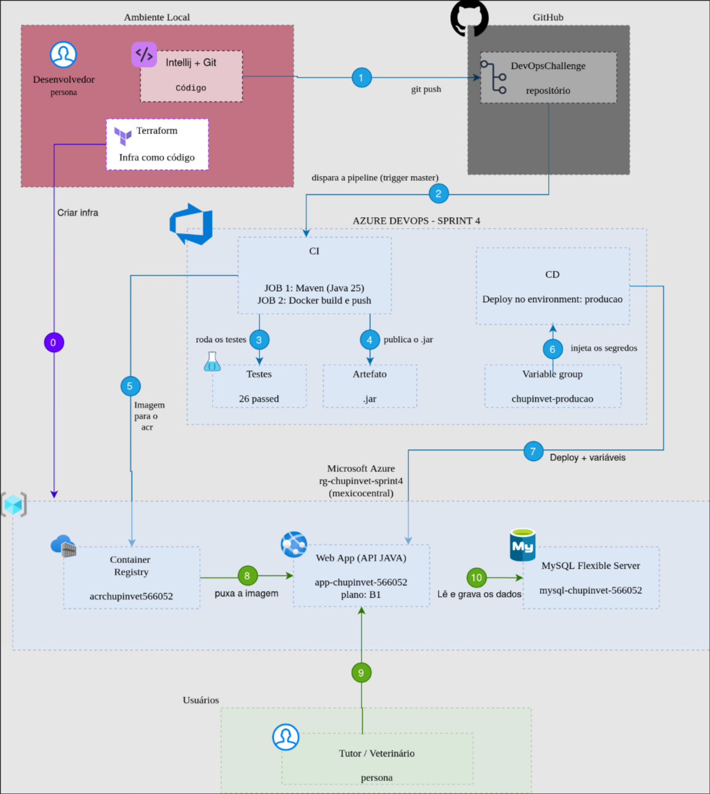

# ChupinVet API · DevOps (Sprint 4)

O **ChupinVet** é a solução do grupo para o Challenge **CLYVO VET 2026 (FIAP)**. Ele acompanha a saúde do pet de forma contínua: o tutor registra no **diário** como o pet está (humor, alimentação, água, comportamento, sintomas e peso) e o veterinário acompanha esse histórico entre as consultas.

Este repositório é a entrega de **DevOps Tools & Cloud Computing**: a API Java do ChupinVet com **banco MySQL em nuvem (PaaS)** e uma **pipeline CI/CD no Azure DevOps** que testa, gera o artefato, publica a imagem e faz o deploy no **Azure Web App** a cada alteração na branch `master`.

| | |
|---|---|
| **Aplicação** | https://app-chupinvet-566052.azurewebsites.net/swagger-ui.html |
| **Azure DevOps** | [PLACEHOLDER: link do projeto] |
| **Vídeo** | [PLACEHOLDER: link do YouTube] |

## Integrantes

| Nome | RM | Turma |
|---|---|---|
| Agatha Yie Won Yun | RM561507 | 2TDSA |
| Ana Claudia Fernandes Martins | RM561190 | 2TDSR |
| Samantha Faruolo Galdi | RM554794 | 2TDSA |
| Vitor Fria Dalmagro | RM566052 | 2TDSA |

## O que a aplicação faz

API REST que conecta **responsáveis** (tutores) e **veterinários**:
- cadastro e login com **JWT**, com dois papéis (`ROLE_RESPONSAVEL` e `ROLE_VETERINARIO`);
- CRUD de **pets** e do **diário** de cada pet;
- regra de **posse**: o tutor só acessa os próprios pets e diários; o veterinário consulta os de qualquer tutor.

## Stack

| Camada | Tecnologia |
|---|---|
| Aplicação | Java 25, Spring Boot 4 (Web, Security, Data JPA), JWT, Swagger |
| Testes | JUnit 5, Mockito, MockMvc e H2 (26 testes) |
| Container | Dockerfile multi-stage com `jlink` (JRE enxuto), Alpine e usuário não-root |
| Banco em nuvem | **Azure Database for MySQL Flexible Server** 8.4 (PaaS) |
| Execução | **Azure Web App for Containers** (Linux, plano B1) |
| Registro de imagens | **Azure Container Registry** (ACR) |
| Infraestrutura | **Terraform** (provider `azurerm`) |
| CI/CD | **Azure DevOps Pipelines** (YAML), código no **GitHub** |
| Ambiente local | Podman + `podman-compose` |

## Arquitetura e fluxo CI/CD



| Nº | De → para | O que acontece |
|---|---|---|
| 0 | Terraform → Azure | Cria a infraestrutura uma vez: Web App, ACR e MySQL |
| 1 | IntelliJ + Git → GitHub | `git push` na branch `master` |
| 2 | GitHub → CI | A pipeline dispara sozinha (trigger `master`) |
| 3 | CI → Testes | Compila e roda os 26 testes (H2); resultado na aba Tests |
| 4 | CI → Artefato | Publica o `.jar` no Azure DevOps |
| 5 | CI → ACR | Build e push da imagem (tags `BuildId` e `latest`) |
| 6 | Variable group → CD | Injeta os segredos do banco e do JWT (`***`) |
| 7 | CD → Web App | Deploy da nova imagem e das variáveis de ambiente |
| 8 | ACR → Web App | O Web App puxa a imagem com identidade gerenciada (`AcrPull`) |
| 9 | Tutor / Veterinário → Web App | Acessa a API por HTTPS (app mobile ou Swagger) |
| 10 | Web App → MySQL | Lê e grava os dados (conexão SSL) |

## Pipeline (`azure-pipelines.yml`)

**Gatilho:** todo commit na `master` (mudanças só em `terraform/` ou `scripts/` não disparam).

**Stage CI**
1. **Build e testes**: roda dentro do container `maven:3-eclipse-temurin-25`, porque o projeto usa Java 25. Compila, executa os 26 testes, publica os resultados (aba **Tests**) e publica o artefato `chupinvet-api-jar` com o `.jar`.
2. **Imagem**: só roda se o job anterior passar. Gera a imagem com o `Dockerfile` e envia ao ACR com as tags `$(Build.BuildId)` e `latest`.

**Stage CD** (só depois do CI e só na `master`)
- Job de *deployment* no environment `producao`, que guarda o histórico de deploys.
- `AzureWebAppContainer@1` troca a imagem do Web App pela recém-gerada e grava as variáveis de ambiente.

### Segredos
Nenhuma senha fica no repositório.

| Segredo | Onde fica |
|---|---|
| Usuário e senha do MySQL, `JWT_SECRET` | Variable group **`chupinvet-producao`** (Pipelines → Library), marcados como secretos; aparecem como `***` nos logs e só são usados no stage CD |
| Senha do MySQL no Terraform | Variável de ambiente `TF_VAR_mysql_admin_password`, definida no terminal por `terraform/preparar-variaveis.sh` |
| Ambiente local | Arquivo `.env` (fora do git); modelo em `.env.example` |
| Acesso da pipeline ao Azure e ao ACR | Service connections `sc-azure-chupinvet` e `sc-acr-chupinvet` |

## Banco de dados

**Azure Database for MySQL Flexible Server** (`mysql-chupinvet-566052`), banco `chupinvet`. O DDL e a carga inicial estão em [`script_bd.sql`](script_bd.sql): tabelas `usuario`, `responsavel`, `veterinario`, `pet` e `diario`, além de 3 usuários de exemplo (senha `senha123`). A API usa `ddl-auto=validate`, ou seja, confere o schema mas nunca o altera.

## Como reproduzir

### 1. Infraestrutura (Terraform)
Pré-requisitos: Azure CLI (`az login`) e Terraform.
```bash
cd terraform
source preparar-variaveis.sh     # pede a senha do MySQL (Enter gera uma) e libera o seu IP no firewall
terraform init
terraform plan
terraform apply
```
O `apply` cria, no grupo `rg-chupinvet-sprint4` (mexicocentral), o ACR, o App Service Plan B1, o Web App, o MySQL Flexible Server, o database e as regras de firewall, e **já carrega o banco**: o recurso `terraform_data.carga_banco` roda o `scripts/carregar-banco.sh`, que executa o `script_bd.sql` (tabelas e dados de exemplo). Se as tabelas já existirem, ele não faz nada.

### 2. Consultar o banco
```bash
./scripts/conectar-banco.sh "SHOW TABLES;"     # da raiz do repositório
```
O script descobre o endereço do banco pela saída do Terraform e usa o cliente `mysql` de um container temporário, sem instalar nada.

### 3. Azure DevOps
1. Service connections: **Azure Resource Manager** (`sc-azure-chupinvet`, escopo no grupo de recursos) e **Docker Registry / ACR** (`sc-acr-chupinvet`).
2. Library → variable group `chupinvet-producao`: `SPRING_DATASOURCE_URL` e, como secretos, `SPRING_DATASOURCE_USERNAME`, `SPRING_DATASOURCE_PASSWORD` e `JWT_SECRET`.
3. Environments → `producao`.
4. Pipelines → New pipeline → **GitHub (YAML)** → este repositório → *Existing Azure Pipelines YAML file* → `/azure-pipelines.yml`.

A partir daí, cada commit na `master` executa CI e CD sozinho.

### Ambiente local (sem Azure)
```bash
cp .env.example .env          # e troque os valores
podman-compose up -d --build
```
Swagger em http://localhost:8080/swagger-ui.html.

## Testando o CRUD

No Swagger: `POST /auth/login` com `ana.costa@teste.com` / `senha123`, copie o `token`, clique em **Authorize** e use os endpoints de `/pets` e `/diarios`.

| Operação | Endpoint |
|---|---|
| Inserir | `POST /pets` |
| Consultar | `GET /pets` · `GET /pets/{id}` |
| Atualizar | `PUT /pets/{id}` |
| Apagar | `DELETE /pets/{id}` |

Para conferir cada operação direto no banco (da raiz do repositório, depois do `source terraform/preparar-variaveis.sh`):
```bash
./scripts/conectar-banco.sh "SELECT id_pet, nm_pet, tp_especie, nm_raca, qtd_idade_pet, vl_peso, responsavel_id_responsavel FROM pet;"
```
Sem argumento, `./scripts/conectar-banco.sh` abre o prompt `mysql>` para digitar os comandos.

## Estrutura

```txt
├── azure-pipelines.yml   => pipeline CI/CD
├── terraform/            => infraestrutura como código (Web App, ACR, MySQL)
├── scripts/              => carregar e consultar o MySQL da nuvem
├── Dockerfile            => imagem da API (multi-stage, jlink, não-root)
├── script_bd.sql         => DDL e carga inicial do MySQL
├── compose.yml           => ambiente local (API + MySQL)
├── mysql/                => imagem do MySQL usada só no ambiente local
├── IMAGES/               => diagrama da arquitetura
└── src/                  => código da API e testes
```

---

DevOps Tools & Cloud Computing · FIAP